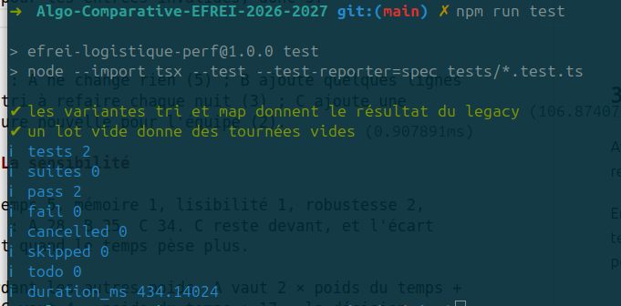

# Grille comparative - ADR-001 (affectation des colis aux livreurs)

## 1. Les critères et leur poids pour ce ticket

| Critère | Ce qu'on mesure ou ce qu'on juge | Poids (somme = 10) |
| --- | --- | --- |
| Temps | minutes de nuit à 15 000 colis : couples x 3,26 ms, plus le calcul, face au timing de 43 min | 4 |
| Mémoire | tas relevé par le harness à 10 000 colis, lu comme un ordre de grandeur | 1 |
| Lisibilité | on part de 5, -1 par idée à connaître pour comprendre le code (Set, Map, tri par index) | 2 |
| Robustesse | npm test, puis le doublon triple ; vides et entrées invalides | 2 |
| Cout de mise en oeuvre | lignes changées, dépendances, données à préparer chaque nuit | 1 |

## 2. Les options, note de 1 à 5 par critère

| Option | Temps | Mémoire | Lisibilité | Robustesse | Coût | Total pondéré |
| --- | --- | --- | --- | --- | --- | --- |
| A (legacy) | 2 | 3 | 4 | 3 | 5 | 30 |
| B (tri) | 2 | 3 | 3 | 3 | 3 | 26 |
| C (map) | 4 | 3 | 3 | 3 | 2 | 33 |

Barème du temps (fixé avant de mesurer, sur le temps de 43 min) : 5 sous 20 min, 4 sous 43, 3 sous 65, 2 sous 90, 1 au-dela.

- Temps : A et B font 1 271 770 couples à 15 000 colis, soit environ 69 min, donc 2 ; C en fait 651 031, soit environ 35 min, donc 4.
- Mémoire : les relevés bougent d'un facteur 2 ou plus d'un lancement à l'autre, donc même note pour les trois.
- Lisibilité : A demande une seule idée, B demande de comprendre le tri par index, C demande une Map et un Set.
- Robustesse : npm run test passe, le doublon triple est affecté une fois dans les trois options, mais rien n'est prévu pour les entrées invalides, donc 3.

- Coût : A ne change rien (5).
    B ajoute quelques lignes et un tri à refaire chaque nuit (3).
    C ajoute une structure nouvelle pour l'équipe (2).

## 3. La sensibilité

Avec temps 5, mémoire 1, lisibilité 1, robustesse 2, coût 1 : A 28, B 25, C 34. C reste devant, et l'écart grandit quand le temps pèse plus.

En gardant les autres poids, A vaut 2 × poids du temps + 22 et C vaut 4 × poids du temps + 17 : la décision bascule vers A quand le temps pèse moins de 2,5. Avec un poids de 4, on a de la marge,